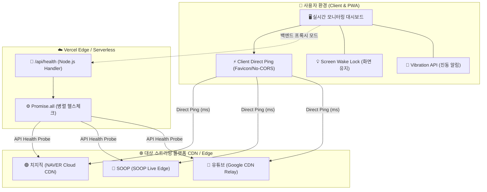
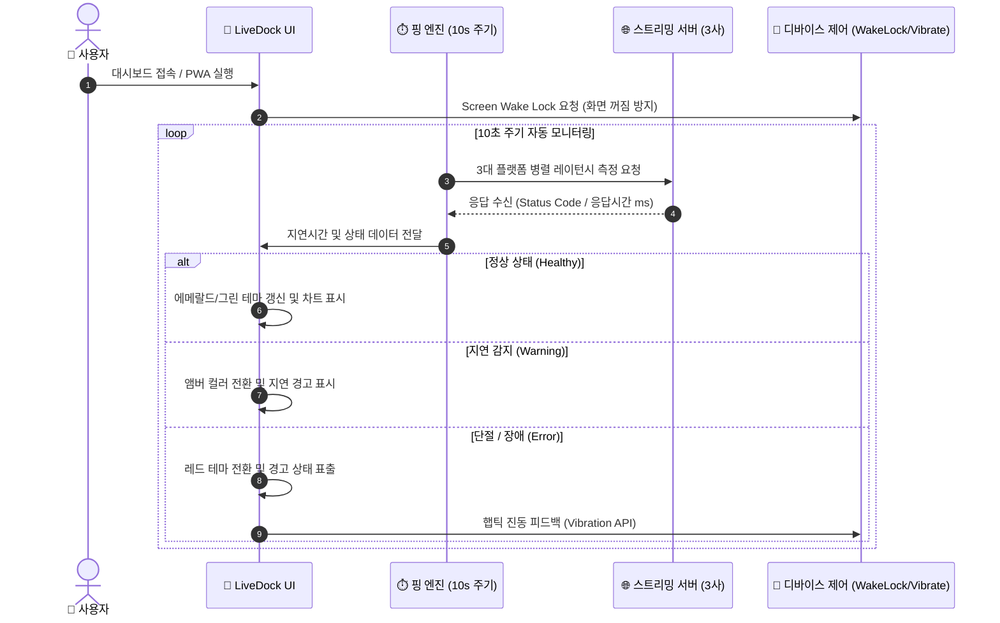
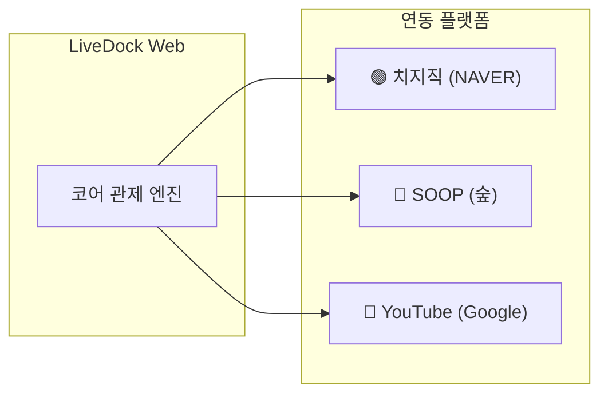

# 📺 LiveDock Web

<div align="center">


**치지직(CHZZK) · SOOP(숲) · 유튜브(YouTube)**  
실시간 스트리밍 서버 헬스체크 & 지연시간(Latency) 모니터링 대시보드

---

[](https://vercel.com)
[](https://web.dev/progressive-web-apps/)
[](https://developer.mozilla.org/en-US/docs/Web/JavaScript)
[](LICENSE)
[](#-모니터링-대상-플랫폼)

[라이브 데모 둘러보기](#-빠른-시작-quick-start) • [주요 기능](#-핵심-기능) • [시스템 구조도](#-시스템-아키텍처) • [동작 워크플로우](#-동작-워크플로우)

</div>

<br>

## 💡 프로젝트 소개

**LiveDock Web**은 인터넷 방송 시청자, 스트리머, 그리고 미디어 엔지니어를 위한 **초경량 실시간 스트리밍 서버 모니터링 도구**입니다.

주요 3대 라이브 플랫폼(치지직, SOOP, 유튜브)의 게이트웨이 및 CDN 응답 속도를 10초 주기로 측정하여, 네트워크 병목 현상이나 서버 중계 장애를 즉각적으로 시각화합니다. 

스마트폰 공기계나 태블릿을 모니터링 전용 디스플레이로 활용할 수 있도록 **PWA(홈 화면 추가)**, **Screen Wake Lock(화면 켜짐 유지)**, **가로모드 거치형 UI**를 기본 제공합니다.

---

## 🏗️ 시스템 아키텍처

LiveDock Web은 **클라이언트 직접 핑(GitHub Pages 완전 호환)**과 **Vercel Serverless Function 프록시**의 하이브리드 아키텍처로 설계되었습니다.



---

## 🔄 동작 워크플로우

대시보드 실행부터 자동 갱신, 이상 감지 알림까지의 전체 흐름입니다.



---

## 📊 레이턴시(Latency) 및 상태 진단 기준

LiveDock Web은 응답 속도에 따라 직관적인 시각 피드백을 제공합니다.

| 상태 | 컬러 | 지연시간 (Latency) | 진단 상태 설명 |
| :---: | :---: | :---: | :--- |
| **최상 (Ultra)** | <span style="color:#00FFA3">■</span> `#00FFA3` | `< 80ms` | 엣지 서버와 최적의 경로로 연결됨 (버퍼링 제로) |
| **원활 (Smooth)** | <span style="color:#10B981">■</span> `#10B981` | `80ms ~ 250ms` | 안정적인 일반 고화질 스트리밍 상태 |
| **안정 (Stable)** | <span style="color:#06B6D4">■</span> `#06B6D4` | `250ms ~ 600ms` | 정상 중계 중이나 미세한 버퍼링 가능성 |
| **지연 (Warning)**| <span style="color:#F59E0B">■</span> `#F59E0B` | `600ms ~ 1200ms`| 트래픽 급증 또는 회선 병목 감지 (품질 저하) |
| **장애 (Critical)**| <span style="color:#EF4444">■</span> `#EF4444` | `> 1200ms` / 단절 | 세션 타임아웃, 게이트웨이 무응답, 패킷 드롭 |

---

## ✨ 핵심 기능

### 1. 3대 스트리밍 플랫폼 원스톱 모니터링
- **치지직(CHZZK)**: 네이버 클라우드 CDN 엔드포인트 응답성 추적
- **SOOP**: SOOP Live Edge 게이트웨이 상태 확인
- **유튜브(YouTube)**: Google Video 리포트 매핑 및 CDN 릴레이 상태 감지

### 2. 거치형 모니터링에 특화된 UX
- **화면 꺼짐 방지 (`Screen Wake Lock API`)**: 충전기에 꽂아두고 탁상시계처럼 거치해도 화면이 자동으로 꺼지지 않습니다.
- **스마트폰 가로모드 및 PWA 최적화**: 홈 화면에 추가하면 브라우저 주소창이 사라진 네이티브 앱 형태의 풀스크린 모드로 구동됩니다.
- **기기 오프라인 자동 감지**: 내 네트워크가 끊겼을 때와 스트리밍 서버가 다운되었을 때를 구분하여 사용자에게 알립니다.

### 3. 복합 감각 알림 시스템
- **동적 컬러 인디케이터**: 숫자를 보지 않아도 카드의 색상만으로 상태 파악 가능
- **진동 햅틱 피드백 (`Vibration API`)**: 서버 단절이나 지연 등 이상 상태 감지 시 진동으로 경고

---

## 🎯 모니터링 대상 플랫폼



- **치지직 (CHZZK)**: `https://chzzk.naver.com`
- **SOOP (숲)**: `https://www.sooplive.com`
- **유튜브 (YouTube)**: `https://www.youtube.com`

---

## 📁 프로젝트 구조

```text
LiveDock_web/
├── 📁 api/
│   └── 📄 health.js          # Vercel Serverless Function (병렬 헬스체크 백엔드)
├── 📁 public/
│   ├── 📄 index.html         # 메인 대시보드 UI (Semantic HTML5)
│   ├── 📄 app.js             # 클라이언트 핑, Wake Lock, 진동, 렌더링 로직
│   ├── 📄 style.css          # 네온 다크 테마 및 반응형 가로모드 스타일
│   └── 📄 manifest.json      # 모바일 홈화면 설치를 위한 PWA 매니페스트
├── 📄 index.html             # 메인 진입점 (리디렉터)
├── 📄 local_dev.js           # 로컬 개발용 제로 디펜던시 정적 웹서버
├── 📄 vercel.json            # Vercel 서버리스 라우팅 및 캐시 정책
├── 📄 package.json           # 프로젝트 메타데이터 및 실행 스크립트
└── 📄 README.md              # 프로젝트 문서
```

---

## 🚀 빠른 시작 (Quick Start)

별도의 복잡한 빌드 과정(Webpack, Vite 등) 없이 즉시 실행할 수 있습니다.

### 1. 저장소 복제 (Clone)
```bash
git clone https://github.com/sh11025/LiveDock_web.git
cd LiveDock_web
```

### 2. 로컬 개발 서버 실행
Node.js 내장 모듈만 사용하는 경량 웹서버가 포함되어 있어 추가 의존성 설치 없이 바로 시작할 수 있습니다.
```bash
# 개발 서버 시작
npm run dev
# 또는
node local_dev.js
```
브라우저에서 `http://localhost:3000`으로 접속합니다.

---

## 🚢 배포 가이드 (Deployment)

### Vercel 배포 (권장)
Vercel CLI 또는 GitHub 연동을 통해 원클릭 배포가 가능하며, `/api/health` 서버리스 함수가 자동 활성화됩니다.
```bash
npm i -g vercel
vercel
```

### GitHub Pages 배포
정적 파일(`public/`)만으로도 브라우저 직접 핑 모드를 통해 완벽하게 작동하므로 GitHub Pages 정적 호스팅으로도 즉시 서비스가 가능합니다.

---

## 🛠️ 기술 스택 (Tech Stack)

| 구분 | 사용 기술 |
| :--- | :--- |
| **Frontend** | Vanilla JavaScript (ES6+), HTML5, CSS3 (Modern Flex/Grid, Glassmorphism) |
| **Web APIs** | `Screen Wake Lock API`, `Vibration API`, `Fetch API`, `Navigator.onLine` |
| **PWA** | Web App Manifest, Standalone Fullscreen Mode |
| **Backend / Proxy** | Node.js Serverless Function (Vercel) |
| **Hosting** | Vercel / GitHub Pages |

---

## 📄 라이선스 (License)

본 프로젝트는 [MIT License](LICENSE)를 따릅니다.
